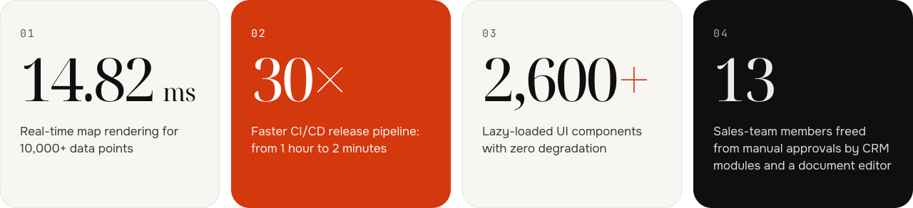
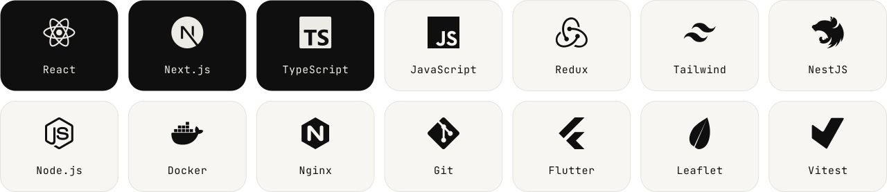

<picture>
<source media="(prefers-color-scheme: dark)" srcset="assets/banner-dark.svg">
<source media="(prefers-color-scheme: light)" srcset="assets/banner-light.svg">

</picture>

[**Portfolio ↗**](https://portfolio-iota-peach-jf712svhsu.vercel.app) &nbsp;·&nbsp; [**Résumé · PDF ↓**](https://portfolio-iota-peach-jf712svhsu.vercel.app/Daniil_Grebnev_Resume.pdf) &nbsp;·&nbsp; [**Telegram**](https://t.me/daniilgral) &nbsp;·&nbsp; [**Email**](mailto:danilgrebneff@gmail.com)

 

- **Frontend developer**, 4+ years: React, Next.js, TypeScript
- Building CRM platforms, real-time maps, analytics dashboards and document editors
- Based in **Novi Sad, Serbia**, working remote and async
- **Available for an immediate start**

## Key achievements

<picture>
<source media="(prefers-color-scheme: dark)" srcset="assets/achievements-dark.svg">
<source media="(prefers-color-scheme: light)" srcset="assets/achievements-light.svg">

</picture>

## Stack

<picture>
<source media="(prefers-color-scheme: dark)" srcset="assets/stack-dark.svg">
<source media="(prefers-color-scheme: light)" srcset="assets/stack-light.svg">

</picture>

